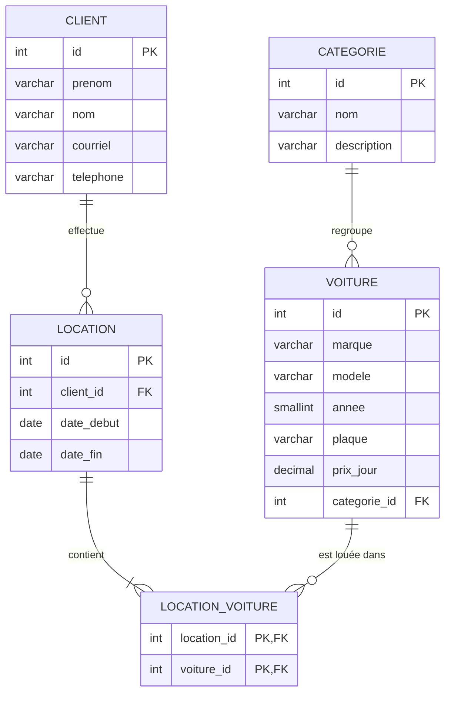

# Pie-IX Location

Système web de location de voitures en PHP orienté objet avec MySQL (TP1, 582-31B-MA).

## Description

Pie-IX Location est l'outil du comptoir d'une agence de location. L'employé peut gérer la flotte de voitures (classées par catégorie), le fichier des clients et les locations. Une location appartient à un client et peut contenir plusieurs voitures. Le système calcule le total de chaque location (prix par jour × nombre de jours) et refuse de louer une voiture déjà réservée sur la même période.

Toutes les opérations (ajouter, afficher, modifier, supprimer) passent par les méthodes des classes du dossier `Classe/`.

## Base de données (5 tables)

- `categorie` 1-N `voiture` : une catégorie contient plusieurs voitures.
- `client` 1-N `location` : un client peut faire plusieurs locations.
- `location` N-N `voiture` via la table pivot `location_voiture`.



## Classes

Inspiré du cours (séances 8-9) :

- `CRUD` hérite de `PDO`. Son constructeur ouvre la connexion, et ses méthodes `select()`, `selectId()`, `insert()`, `update()` et `delete()` servent à toutes les tables.
- `Categorie`, `Voiture`, `Client` et `Location` héritent de `CRUD`. Chacune déclare sa table, ses colonnes permises (`$fillable`) et ses méthodes propres, par exemple `Voiture::selectAvecCategorie()` (jointure sur la clé étrangère) ou `Location::ajouterVoitures()` (table pivot).

Chaque entité a ses pages : `-index` (liste), `-show` (détail), `-create` / `-store` (ajout), `-edit` / `-update` (modification) et `-delete` (suppression).

## Installation

1. Importer `location_auto.sql` dans MySQL (phpMyAdmin ou `mysql -u root < location_auto.sql`).
2. Ajuster les identifiants dans le constructeur de `Classe/CRUD.php`.
3. Ouvrir `index.php` dans le navigateur (PHP 8.1 ou plus).

## Structure

```
location-auto/
├── Classe/          CRUD, Categorie, Voiture, Client, Location
├── css/style.css
├── inc/             en-tête, pied de page, champs de formulaires, fonctions
├── index.php        accueil
├── voiture-*.php    index, show, create, store, edit, update, delete
├── categorie-*.php  index, create, store, edit, update, delete
├── client-*.php     index, show, create, store, edit, update, delete
├── location-*.php   index, show, create, store, edit, update, delete
└── location_auto.sql
```
